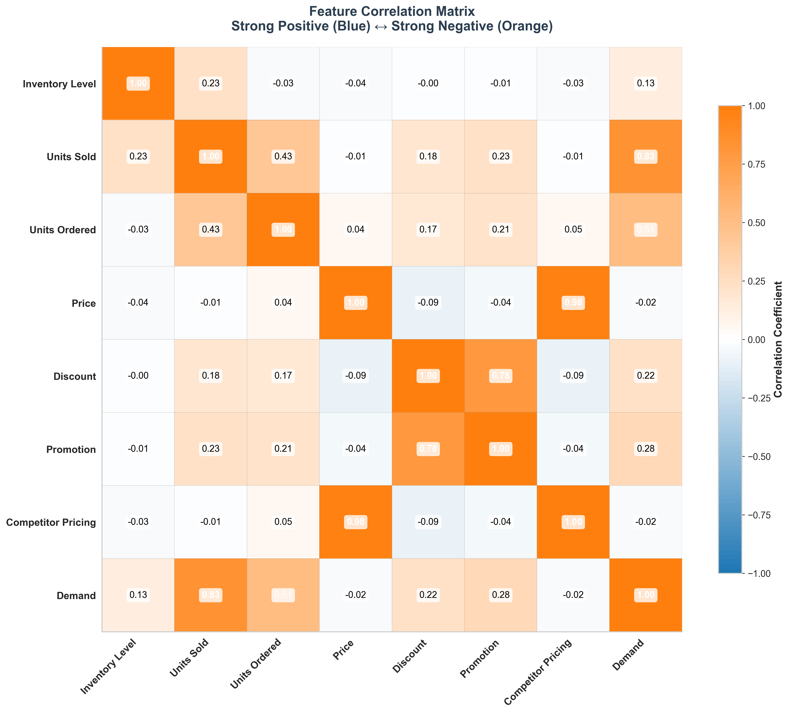
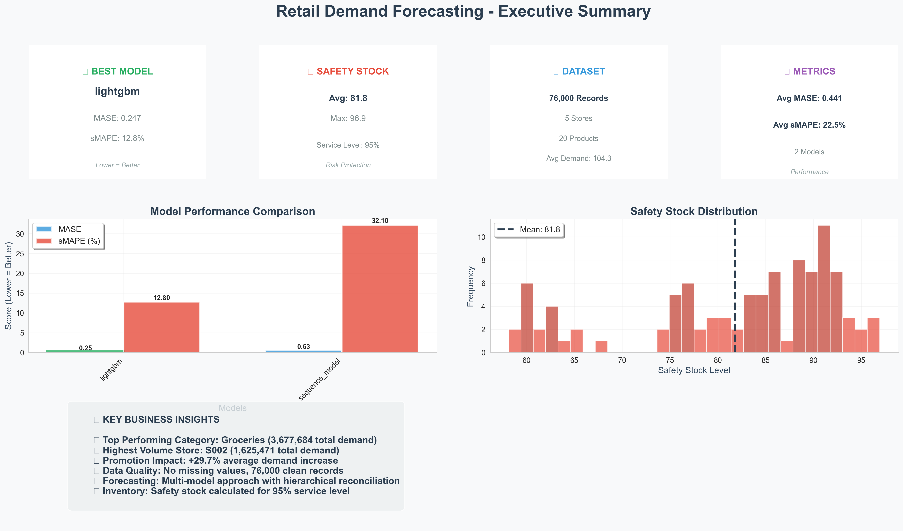
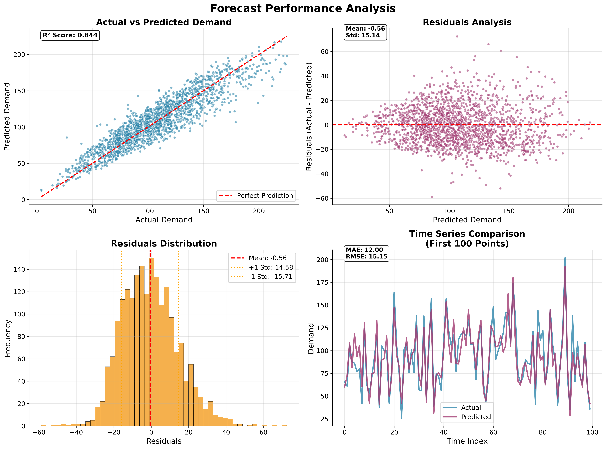
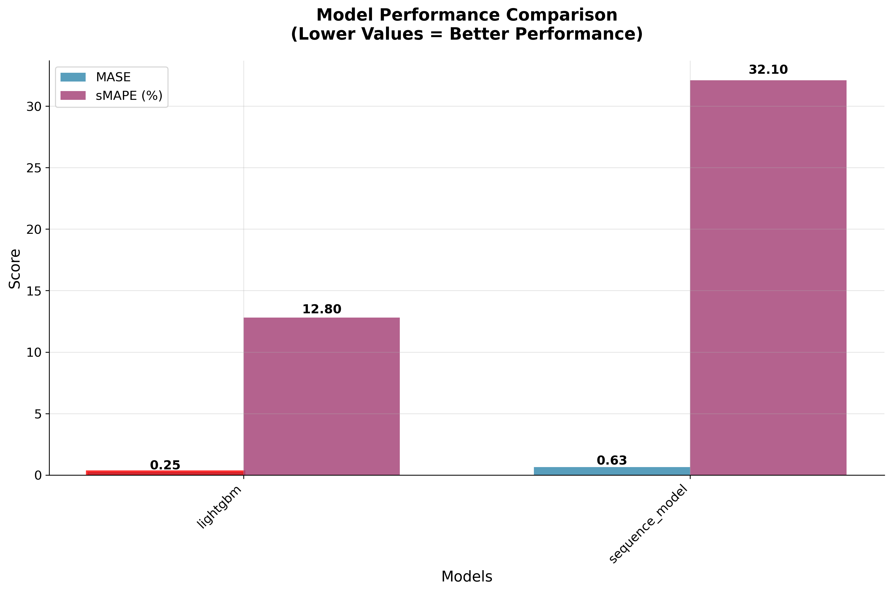

# 🚀 GitHub Repository Setup Guide

## Step-by-Step Instructions to Upload Your Retail Forecasting Project

### **Step 1: Initialize Git Repository**

```bash
# Navigate to your project directory
cd C:\Users\mojab\OneDrive\Desktop\Retail2

# Initialize git repository
git init

# Add all files to staging
git add .

# Create initial commit
git commit -m "Initial commit: Retail Demand Forecasting System with enhanced visualizations"
```

### **Step 2: Create GitHub Repository**

1. **Go to GitHub.com** and sign in to your account
2. **Click the "+" icon** in the top right corner
3. **Select "New repository"**
4. **Repository settings:**
   - **Repository name**: `retail-demand-forecasting`
   - **Description**: `Comprehensive multi-store, multi-SKU retail demand forecasting system with hierarchical reconciliation and safety stock optimization`
   - **Visibility**: Public (recommended for portfolio)
   - **Initialize with**: None (we already have files)

### **Step 3: Connect Local Repository to GitHub**

```bash
# Add GitHub repository as remote origin
git remote add origin https://github.com/YOUR_USERNAME/retail-demand-forecasting.git

# Push to GitHub
git push -u origin main
```

### **Step 4: Verify Upload**

Check that all files are uploaded:
- ✅ `retail_demand_forecasting.py`
- ✅ `modern_visualizations.py`
- ✅ `improved_visualizations.py`
- ✅ `create_clean_forecast_plots.py`
- ✅ `requirements.txt`
- ✅ `README.md`
- ✅ `LinkedIn_Post.md`
- ✅ `PROJECT_SUMMARY.md`
- ✅ `forecast_results.csv`
- ✅ `model_performance_metrics.csv`
- ✅ `safety_stock_recommendations.csv`
- ✅ `visualizations/` folder with all 4 PNG files

### **Step 5: Add Repository Description**

In your GitHub repository:
1. **Click "Edit"** next to the repository description
2. **Add**: `🏪 Multi-store retail demand forecasting with ARIMA, LightGBM & safety stock optimization. Features hierarchical reconciliation, modern visualizations, and business-ready insights.`
3. **Add topics/tags**: `retail-analytics`, `demand-forecasting`, `machine-learning`, `python`, `lightgbm`, `inventory-management`, `data-science`

### **Step 6: Create a Professional README**

Your README.md is already comprehensive! It includes:
- Project overview and goals
- Dataset information
- Model performance results
- Installation instructions
- Usage examples
- Business applications
- Technical highlights

### **Step 7: Add Visualizations to README**

Add this section to your README.md to showcase the visualizations:

```markdown
## 📊 Key Visualizations

### Ultra-Clear Correlation Matrix


### Modern Executive Dashboard


### Forecast Performance Analysis


### Model Performance Comparison

```

### **Step 8: Repository Structure**

Your final repository structure will be:
```
retail-demand-forecasting/
├── 📄 retail_demand_forecasting.py
├── 📄 modern_visualizations.py
├── 📄 improved_visualizations.py
├── 📄 create_clean_forecast_plots.py
├── 📄 requirements.txt
├── 📄 README.md
├── 📄 LinkedIn_Post.md
├── 📄 PROJECT_SUMMARY.md
├── 📄 .gitignore
├── 📁 archive (2)/
│   └── 📄 sales_data.csv
├── 📁 visualizations/
│   ├── 🎨 ultra_clear_correlation_matrix.png
│   ├── 🎨 modern_summary_insights.png
│   ├── 🎨 clean_forecast_analysis.png
│   └── 🎨 clean_performance_summary.png
├── 📄 forecast_results.csv
├── 📄 model_performance_metrics.csv
└── 📄 safety_stock_recommendations.csv
```

### **Step 9: Final GitHub Repository URL**

Once uploaded, your repository will be available at:
`https://github.com/YOUR_USERNAME/retail-demand-forecasting`

### **Step 10: Update LinkedIn Post**

Replace `[Link to be added]` in your LinkedIn post with your actual GitHub URL.

---

## 🎯 **Pro Tips for GitHub Portfolio**

1. **Pin the Repository**: Pin this repo to your GitHub profile
2. **Add Live Demo**: Consider adding a Streamlit/Flask demo
3. **Documentation**: Your README is already excellent!
4. **Issues/Projects**: Use GitHub's project management features
5. **Releases**: Create a v1.0 release for this project

---

## ✅ **Verification Checklist**

- [ ] Git repository initialized
- [ ] All files committed locally
- [ ] GitHub repository created
- [ ] Remote origin added
- [ ] Code pushed to GitHub
- [ ] Visualizations folder included
- [ ] README displays correctly
- [ ] Repository description added
- [ ] Topics/tags added
- [ ] LinkedIn post updated with GitHub URL

**Your retail forecasting project is now ready to impress on GitHub!** 🚀
